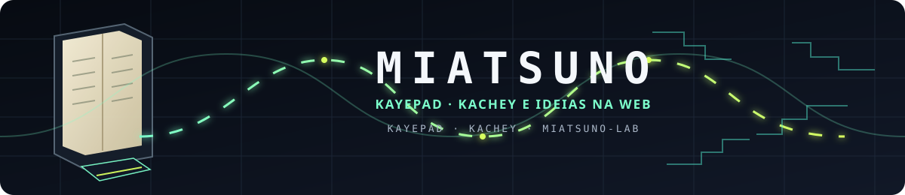

  

<h1 align="center">MIATSUNO</h1>

  <code>code</code> · <code>systems</code> · <code>imagination</code>

  <em>Building quietly. Leaving traces in public.</em>

## / about

I build, study, and publish things that live somewhere between software, systems, and imagination.

> The visible layer is only the interface.

## / projects

### [Kachey](https://github.com/MIATSUNO/Kachey)

A project by MIATSUNO — developed in public, one layer at a time.

### [Kayepad](https://github.com/MIATSUNO/Kayepad)

A project I contribute to and am associated with as an author. This profile does not claim ownership of the project.

### Other public work

Tools, experiments, notes, and unfinished ideas that deserve a place in the open.

## / currently

- Building **Kachey**
- Contributing to **Kayepad**
- Exploring creative software, systems, and open-source workflows
- Turning strange ideas into working prototypes

## / contact

The best way to reach me is through the public projects and repositories on this profile.

  © MIATSUNO · built in public

